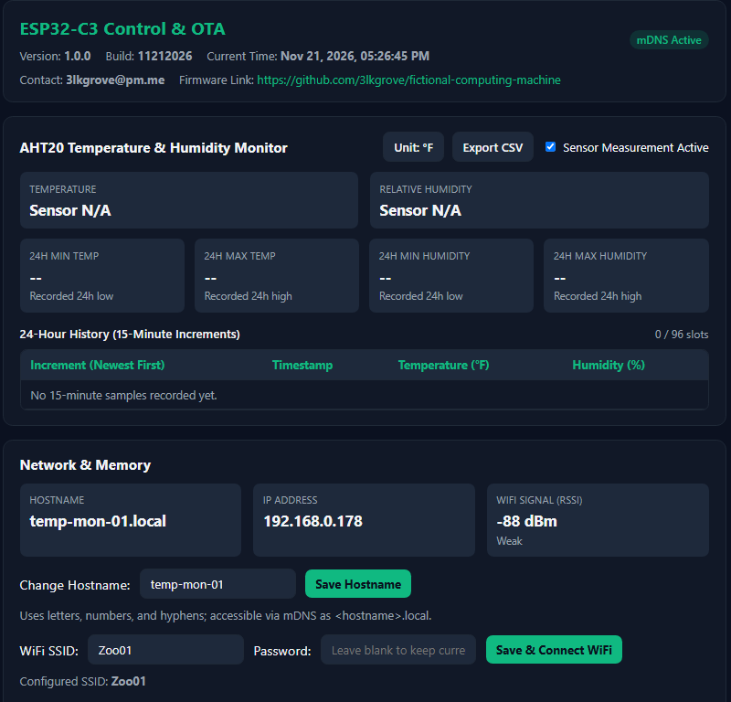
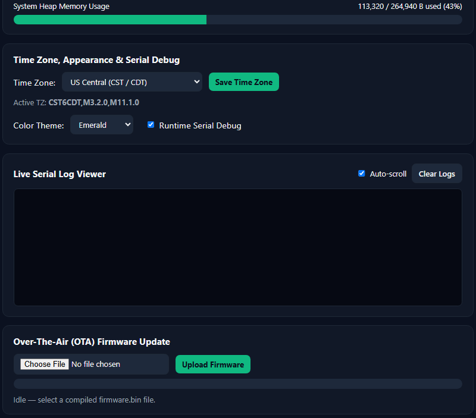

# Cheap ESP32 Temperature Monitor-Display
# 🌡️ ESP32-C3 Temperature & Humidity Telemetry Monitor (`v1.4.0`)

[](https://platformio.org/)
[](https://www.arduino.cc/)
[](https://www.adafruit.com/product/4566)
[](#)

A responsive, single-page web telemetry and Over-The-Air (OTA) monitor built in **PlatformIO** for the **ESP32-C3** paired with an **AHT20** temperature and relative humidity sensor. Designed for headless or benchtop monitoring with persistent `Preferences` storage, automatic fallback Access Point recovery, POSIX time-zone-aware timestamps, and 24-hour 15-minute CSV data export.

---

## ✨ Key Features

* **🌡️ Live AHT20 Environmental Monitoring**
  * Polls temperature and relative humidity (`Wire` on `SDA = GPIO 5`, `SCL = GPIO 6`).
  * Switch seamlessly between **°F** and **°C** directly from the Web GUI (persisted in NVS `Preferences`).
  * Toggle sensor measurement on/off at runtime without rebooting the controller.
* **📊 24-Hour History (15-Minute Increments), Min/Max & CSV Export**
  * Ring buffer stores up to **96 slots** (24 hours at 15-minute intervals) with local timestamps and uptime fallbacks.
  * Computes **24h Min/Max Temp** and **24h Min/Max Humidity** automatically.
  * Exports a downloadable `esp32c3-24h-history.csv` file containing `Timestamp_Local`, `Unix_Epoch`, `Increment_Offset_Min`, `Uptime_Sec`, `Temp_C`, `Temp_F`, and `Humidity_Pct`.
* **🕒 NTP Clock & POSIX Time Zone Selector**
  * Syncs clock via `pool.ntp.org` and `time.nist.gov` with automatic Daylight Saving Time support via POSIX `TZ` strings (defaults to `CST6CDT,M3.2.0,M11.1.0`).
  * Includes common regional presets plus a **Custom POSIX TZ** input saved to `Preferences`.
* **📡 Resilient WiFi STA, mDNS & Fallback AP Mode**
  * Connects in Station (`WIFI_STA`) mode, advertises `http://<hostname>.local` via **mDNS**, and displays live **WiFi Signal (RSSI in dBm)** with signal quality rating.
  * Allows updating **Hostname**, **WiFi SSID**, and **WiFi Password** live from the browser.
  * Automatically spins up a **Fallback Access Point** (`ESP32C3-Setup` at `http://192.168.4.1`) if connection fails at boot or after saving credentials, then tears down the AP once station WiFi connects.
* **💡 Built-In WiFi Status LED Indicator**
  * Illuminates while booting, disconnected, or in Fallback AP mode, and turns **OFF** once station WiFi connects (configurable via `LED_BUILTIN_PIN` and `LED_ACTIVE_HIGH`).
* **🎨 Themes, Live Serial Log Viewer & Browser OTA**
  * Switch between **Ocean Blue**, **Emerald**, **Amber**, and **Violet Slate** themes.
  * Toggle runtime serial debug output, inspect a ring-buffered **Live Serial Log Viewer** in the browser with auto-scroll and clear controls, and push `.bin` firmware updates with a live percentage progress bar via `/update`.

    
    

---

## 🛠️ Hardware Required

| Component | Specification / Role | Notes |
| :--- | :--- | :--- |
| **Microcontroller** | ESP32-C3 Development Board (`esp32-c3-devkitm-1`) | RISC-V single-core with native USB Serial/JTAG & WiFi |
| **Temp/Humidity Sensor** | **Adafruit AHT20** (I2C Temperature & Humidity) | `3.3V` logic/power, I2C address `0x38` |
| **Onboard Status LED** | Built-in LED on `GPIO 8` (default) | Override `LED_BUILTIN_PIN` / `LED_ACTIVE_HIGH` per board |
| **Wiring & Power** | USB-C data cable + jumper wires (or custom PCB) | Ensure solid `3.3V` and `GND` rails for clean I2C reads |

---

## 🔌 Wiring Diagram

### Pin Connection Table

| AHT20 Sensor Pin | ESP32-C3 Pin | Signal / Function |
| :--- | :--- | :--- |
| `VIN` / `3V3` | `3V3` | `3.3V` regulated supply rail |
| `GND` | `GND` | Common ground reference |
| `SDA` | `GPIO 5` | I2C serial data (`I2C_SDA_PIN = 5`) |
| `SCL` | `GPIO 6` | I2C serial clock (`I2C_SCL_PIN = 6`) |

### Rendered Circuit Diagram

```text
+-----------------------------------+          +---------------------------+
|         ESP32-C3 DevKitM-1        |          |      Adafruit AHT20       |
|                                   |          |                           |
|                         3V3 (3.3V)|--------->| VIN / 3V3                 |
|                                   |          |                           |
|                        GPIO 5 (SDA)|<========>| SDA (I2C Data)           |
|                                   |          |                           |
|                        GPIO 6 (SCL)|--------->| SCL (I2C Clock)          |
|                                   |          |                           |
|                         GND       |<-------->| GND                       |
|                                   |          |                           |
|  [Onboard LED: GPIO 8]            |          |                           |
|   - ON: Boot / Disconnected / AP  |          |                           |
|   - OFF: WiFi Connected           |          |                           |
|                                   |          |                           |
|  [USB-C Port] ------------------->|          |                           |
+-----------------------------------+          +---------------------------+

## Licensing

This project is licensed under the terms of the **GNU General Public License v3.0** (GPL-3.0). The full text of the license can be found in the [LICENSE](LICENSE) file in the root directory of this repository.

Copyright (c) 2026 [@3lkgrove](https://www.github.com/3lkgrove)
